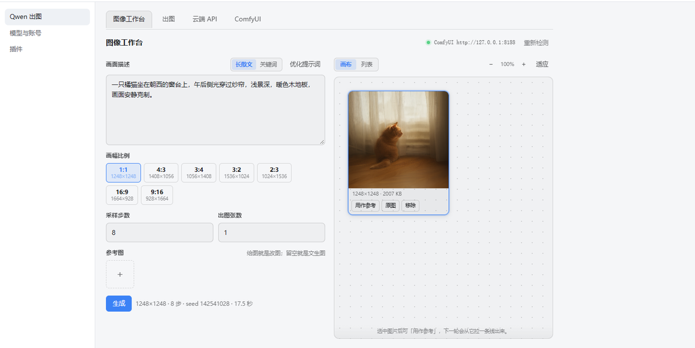
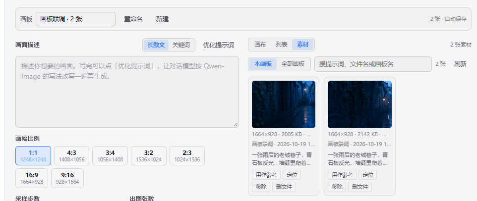

# dsh-image-forge


[](https://www.npmjs.com/package/dsh-image-forge)
[](https://www.npmjs.com/package/dsh-image-forge)
[](https://github.com/Demerier/dsh-image-forge/actions/workflows/ci.yml)
[](LICENSE)
[](https://github.com/topics/dsh-plugin)

在 DeepSeek Harness 里用 Qwen-Image 出图、改图。

说「画一张 16:9 的夏日饮料海报」，出图；丢一张客厅照片说「改成晚上的」，改图。比例、像素由插件换算，不用你查表；成果按**画板**归档，工作台里能看、能摆、能接着改。



**两个入口，一套后端**：对话里说一句话，模型按 Qwen 契约改写后调用工具；或者打开设置页的「图像工作台」点按钮。两边共用同一份配置、同一个输出目录、同一批画板。

**目录**：[能不能用](#能不能用) · [快速开始](#快速开始) · [出图](#出图) · [改图](#改图) · [工作台](#工作台) · [工具](#工具) · [提示词怎么写](#提示词怎么写) · [后端](#后端) · [可能踩的坑](#可能踩的坑) · [许可](#许可) · [更多文档](#更多文档)

---

## 能不能用

需要**本机装好的 ComfyUI + 三个 Qwen-Image 2.1 权重**。文生图、改图（图生图）都跑在这台机器上，
首次下载权重之后完全离线，不联网、不耗云端额度。

- 显存 8 GB 起步（实测机型 RTX 4070 Laptop）。没有 ComfyUI 就照 [部署指引](docs/comfyui-deployment.md) 从零装。
- 插件不自带运行时、不下载权重、不碰 ComfyUI 的配置；它没起来时插件只负责把缺什么说清。

---

## 快速开始

### 1. 安装

插件已发布到 npm（包名 `dsh-image-forge`）。官方 DSH 桌面版内置插件管理器，两种装法任选：

**桌面版界面安装**

打开 DSH 桌面版的「插件」页 →「发现」标签 → 搜索 `dsh-image-forge` → 安装。市场索引源没有收录它也没关系：同页有**直接输入包名安装**的入口，填 `dsh-image-forge` 一样能装。

**命令行安装（npm 包）**

```bash
dsh plugin --profile <profile> add dsh-image-forge
```

也可以装 GitHub 上的最新源码：

```bash
dsh plugin --profile <profile> add github:Demerier/dsh-image-forge
```

装完**完全退出 DSH 再打开**（不是刷新窗口，插件的 `cordis.yml` 在启动时加载）。

> 别用 `npm install` 装它——这是 DSH 插件，脱离宿主跑不起来。
> `pnpm build` 报 `Cannot find package 'ansis'` 时，删掉 `node_modules` 重装（本仓库用 `nodeLinker: hoisted` 绕开这个问题）。

### 2. 把 ComfyUI 指给它

什么都不用填：插件自动探测 8000 / 8188 / … 端口（非回环地址会被拒绝）。缺 Qwen-Image 权重时，
照 [ComfyUI 部署指引](docs/comfyui-deployment.md) 把三个文件放进对应目录，`qwen_image_status` 会告诉你它缺哪个。

9 个配置字段都有默认值，日常一个都不用碰；全部字段见 [docs/configuration.md](docs/configuration.md)。

### 3. 出第一张图

对话里直接说：

> 画一张 16:9 的夏日饮料海报，清凉一点

模型会把它改写成 Qwen 提示词契约再调工具，图片落盘并内联显示在回复里。也可以打开设置页「Qwen 出图」→「图像工作台」，手写提示词点「生成」。

**验收标准**：对话里能看到 `qwen_image_generate` / `qwen_image_edit` / `qwen_image_status` 三个工具；设置页左侧出现「Qwen 出图」。跑不通先调 `qwen_image_status`，它会点名缺什么。

本机改代码时：

```bash
pnpm install
pnpm build
dsh plugin --profile <profile> add <本仓库绝对路径>
```

完整流程（打包、版本号、tarball 安装）见 [docs/local-install.md](docs/local-install.md)。

---

## 出图

在对话里直接说需求就行。模型会把话改写成契约再调工具，你不用管：

```json
{"rewritten_prompt": "A wide photograph of …", "wh_ratio": "16:9"}
```

`wh_ratio` 七档，对应像素（约 1.5MP，32 对齐）：

| `wh_ratio` | 像素 | 备注 |
|---|---|---|
| `1:1` | 1248×1248 | |
| `4:3` | 1408×1056 | |
| `3:4` | 1056×1408 | |
| `3:2` | 1536×1024 | |
| `2:3` | 1024×1536 | |
| `16:9` | 1664×928 | 32 网格上无法精确，偏差 +0.86% |
| `9:16` | 928×1664 | 偏差 −0.86% |

- 要固定像素就传 `width` / `height`（32 的倍数），优先于 `wh_ratio`。
- 图片存为 `<outputDir>/<prefix>_<W>x<H>_<n>.png`，编号自动跳过已占用的名字，重复出图不会覆盖旧的。

---

## 改图

给了参考图就是改图任务。

```text
qwen_image_edit(prompt = <改图指令>, images = ["D:\\pictures\\room.png"], ratio_follow = "image1")
```

画布怎么定，三选一：

| 你说的话 | 传什么 | 画布 |
|---|---|---|
| 明说了比例或像素 | `wh_ratio`（或 `width`+`height`） | 该比例 |
| 没说，但想跟随某张图 | `ratio_follow: "image1"` | 按该图长宽比取最接近的像素 |
| 什么都没说 | 都不传 | 跟随第一张参考图 |

- 路径必须绝对；只认 PNG / JPEG / WebP。
- `wh_ratio` 和 `ratio_follow` 同时传会直接报错，二选一。
- 多张参考图时用 `<image1>` `<image2>` 指明用途，并说清哪张是画布。
- 显存不够就先调小 `width` / `height`。

---

## 工作台

设置页第一个页签。不想每次在对话里贴参数，就在这里点。

- **画幅只有七档**，标的像素就是实际送进 ComfyUI 的像素。
- **传了参考图就是改图**（最多 10 张），留空就是文生图。
- **提示词优化**用当前会话的模型改写，结果写回输入框，你改完再生成。
- **结果是一块画布**：拖空白处平移、滚轮缩放。选中一张点「用作参考」，下一轮就变成改图，新图会从原图拉一条虚线过来，改了哪几轮一眼看清。
- **按画板归档**：顶部切换 / 新建 / 重命名，画布位置自动保存，重开页面回到上次的画板。「素材」页可以跨画板搜索，把图用作参考、定位回画布、或删掉。



ComfyUI 没起来时面板照样打开，顶部会写清查了哪些端口、为什么失败。

> 「优化提示词」需要宿主装了 `@deepseek-ai/dsh-llm`。没有的话只有这个按钮不可用，出图不受影响。

---

## 工具

| 工具 | 用途 | 主要参数 |
|---|---|---|
| `qwen_image_generate` | 出图 | `prompt`、`wh_ratio`、`width`/`height`、`steps`、`seed`、`count`、`preset`、`board` |
| `qwen_image_edit` | 改图 | `prompt`、`images`（1–10 张）、`ratio_follow` 或 `wh_ratio`、`board` |
| `qwen_image_status` | 检查环境 | 无 |

不确定为什么跑不通时，先跑 `qwen_image_status`。它会告诉你 ComfyUI 在不在、三个权重能不能识别、显卡剩多少显存、输出目录能不能写。不产图、不写盘。

`board` 不传时会新建一块画板，把返回的 `board.id` 传回后续调用就能归到同一块。同一组图继续出图 / 改图时记得传——新图和它的来源才会落在同一块画布上。

---

## 提示词怎么写

模型会自动改写，这里只说改写的方向。完整规则见 [T2I 规则](references/t2i_rules.md) 与 [改图规则](references/edit_rules.md)。

| 场景 | 你可以这么说 | 改写方向 |
|---|---|---|
| 海报、页面、多物宽景 | 「画一张夏日饮料海报」 | 一整段英文散文，从背景到顶部到主体再到下方依次描写。**比例不写进正文** |
| 肖像、特写、单品 | 「画我的猫的大头照」 | 同上，顺序是背景 → 姿态 → 头脸 → 身体 → 手持物 → 边缘细节 |
| 单张参考图改图 | 「把这张客厅改成晚上的」 | 只动点名的属性，其余保持。不加 `<image1>` 标签 |
| 多张参考图 | 「把我放进那张客厅照片」 | 必须用 `<image1>` `<image2>` 逐张说明，并指明哪张是画布 |
| 只想问怎么写 | 「这种需求提示词怎么写」 | 只给改写结果，不出图 |

工作台里可切两种风格：「长散文」（约 20 句英文细节描写）和「关键词」（`主体+场景+风格+镜头+氛围+细节修饰`，逗号分隔）。两派都遵守：比例不写进正文、画面里的文字逐字照抄。

---

## 性能：base 与 turbo

唯一影响速度与画质的选择是权重家族（设置页 `comfyModel`）：

- **base**：25 步，官方全量。写实、画面里的中文文字、古典构图用它。
- **turbo**：8 步，快约 2.7×。**没装 turbo 权重会自动退回 `base`**，结果里会有提示。
  盲测 5 题 base 3 : 2 turbo，单张 27–29 s → 9–11 s。turbo 氛围更强，但材质细节、中文小字、印章、古典构图会输给 base。

8 GB 卡（RTX 4070 Laptop）实测：文生图 1312×736 约 2 s/步，1.5MP 的 8 步改图 19–23 s。
全部实测数据见 [docs/configuration.md](docs/configuration.md) 的证据一节。

部署见 [ComfyUI 部署指引](docs/comfyui-deployment.md)。

---

## 可能踩的坑

- 参考图只认 PNG / JPEG / WebP 的文件头，TIFF、AVIF 会被拒绝并说明原因。
- 没有局部重绘、没有放大。素材页只做检索和整理，不做批量导出或调色。
- 插件不会替你装 ComfyUI、不下权重、不改它的启动参数。
- 显存不够时报的是 ComfyUI 自己的 CUDA OOM，插件不做前置检查。卡上同时跑游戏或 Blender 会明显变慢。
- 图在对话里的显示靠工具结果里的 Markdown 绝对路径。

---

## 许可

插件本体 MIT。**权重和官方提示词原文都不随包分发。**

- Qwen-Image-2.1 权重受 **Qwen RESEARCH LICENSE** 约束，限研究用途，商用需自行向权利方取得授权。插件不下载、不携带。
- ComfyUI 是可选外部依赖（GPL-3.0），插件只通过 HTTP 与你的实例通信。
- `skill.md` 和 `references/*.md` 是本插件自撰的规则，不是官方原文。

> 「Qwen」「千问」是阿里巴巴集团商标。本项目是第三方作品，与阿里巴巴无关联、未获其背书。开源许可不授予商标使用权。详见 [docs/license-and-limits.md](docs/license-and-limits.md)。

ComfyUI 后端与工作流占位符协议（`{{prompt}}` / `{{seed}}` / `{{image}}`）参考并移植自 [dsh-image-gen](https://github.com/shanliuling/dsh-image-gen)（Copyright 2026 shanliuling，Apache-2.0），许可全文见 [THIRD-PARTY](THIRD-PARTY/dsh-image-gen/LICENSE)。

---

## 更多文档

| 文档 | 内容 |
|---|---|
| [docs/comfyui-deployment.md](docs/comfyui-deployment.md) | 本机部署：下载、建实例、放权重、校验、排障 |
| [docs/configuration.md](docs/configuration.md) | 14 个配置字段的默认值和边界 |
| [docs/usage-reference.md](docs/usage-reference.md) | 像素怎么算、表外比例、`board` 用法、`status` 各字段 |
| [docs/license-and-limits.md](docs/license-and-limits.md) | 分发和商用前的注意事项 |
| [docs/local-install.md](docs/local-install.md) | 开发：本机构建、打包、tarball 安装 |
| [docs/testing.md](docs/testing.md) | 开发：怎么跑测试 |
| [docs/client-bundle.md](docs/client-bundle.md) | 开发：改客户端和设置页 UI |
| [docs/release-notes-0.2.0.md](docs/release-notes-0.2.0.md) | 0.2.0 改了什么，以及从 0.1.0 升上来要注意什么 |
