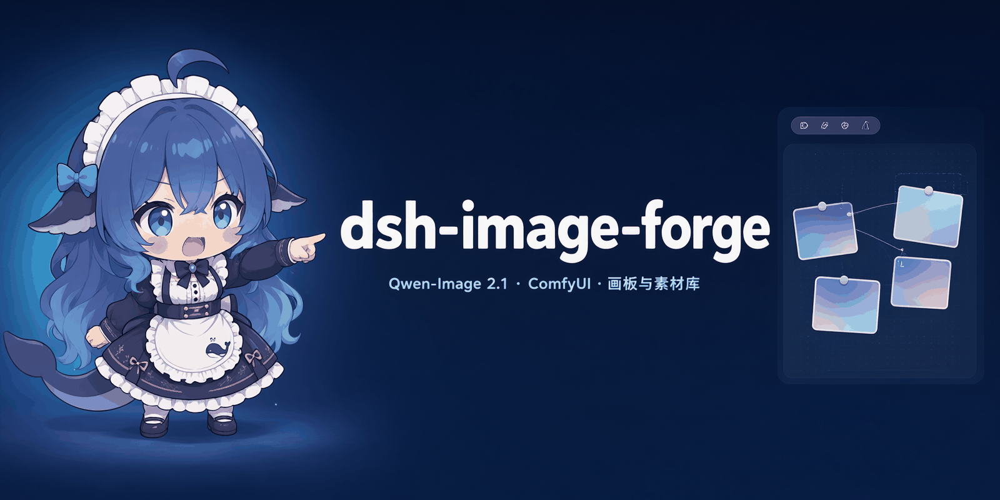
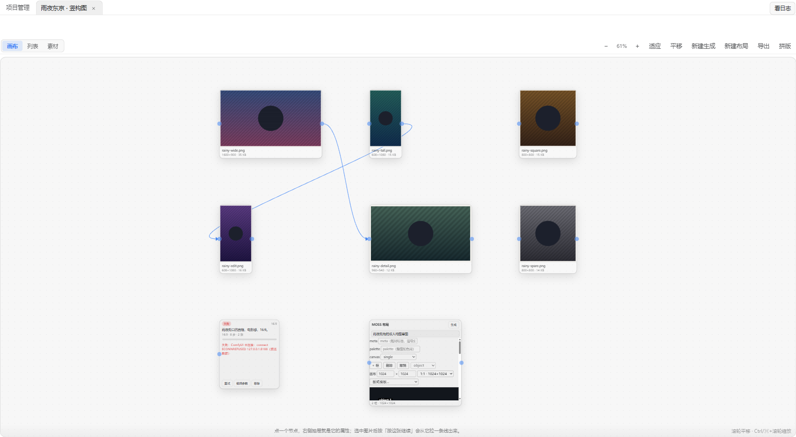
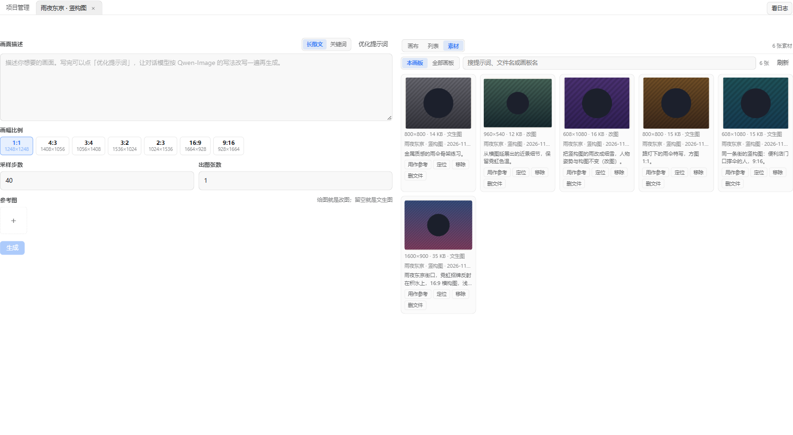

# dsh-image-forge



[](https://www.npmjs.com/package/dsh-image-forge)
[](https://www.npmjs.com/package/dsh-image-forge)
[](https://github.com/Demerier/dsh-image-forge/actions/workflows/ci.yml)
[](LICENSE)
[](https://github.com/topics/dsh-plugin)

在 DeepSeek Harness 里生图、改图：底模是本机的 **Qwen-Image 2.1** 或 **MOSS-Image**，由设置页的 `comfyModel` 选。当前发布版本：`0.4.0`（[发布说明](docs/release-notes-0.4.0.md)）。

说「画一张 16:9 的夏日饮料海报」，出图；丢一张客厅照片说「改成晚上的」，改图。比例、像素由插件换算，不用你查表；成果按**画板**归档，工作台里能看、能摆、能接着改。

0.4.0 的工作台以 React Flow 无限画布为核心：快速合成器、`@` 参考图选择、2K 画布、实时 MOSS 布局节点和分页 ComfyUI 日志都在同一个工作区里。



**两个入口，一套后端**：对话里说一句话，模型按 Qwen 契约改写后调用工具；或者在左侧边栏点「图像工作台」进全局面板点按钮。两边共用同一份配置、同一个输出目录、同一批画板。

**目录**：[能不能用](#能不能用) · [快速开始](#快速开始) · [出图](#出图) · [改图](#改图) · [工作台](#工作台) · [工具](#工具) · [提示词怎么写](#提示词怎么写) · [性能](#性能qwen21-base-与-qwen21-turbo) · [可能踩的坑](#可能踩的坑) · [许可](#许可) · [更多文档](#更多文档)

---

## 能不能用

需要**本机装好的 ComfyUI + 当前底模的三个权重**（默认 Qwen-Image 2.1，也可切 MOSS-Image）。文生图、改图（图生图）都跑在这台机器上，
首次下载权重之后完全离线，不联网、不耗云端额度。

- 显存 8 GB 起步（实测机型 RTX 4070 Laptop）。**已经装过 ComfyUI**：`node scripts/start-comfyui.mjs` 一条命令起后端并等到就绪，`--doctor` 只体检（安装/torch/五个权重/显存）。**没装过**：照 [部署指引](docs/comfyui-deployment.md) 从零装。
- 插件不捆绑模型权重；先用 `--doctor` 查看缺什么，再从工作台或 `image_forge_setup` 下载。下载默认只出计划，必须显式 `confirm: true` 才写盘。

---

## 快速开始

### 1. 安装

插件已发布到 npm（包名 `dsh-image-forge`）。官方 DSH 桌面版内置插件管理器，两种装法任选：

**桌面版界面安装**

打开 DSH 桌面版的「插件」页 →「发现」标签 → 搜索 `dsh-image-forge` → 安装。市场索引源没有收录它也没关系：同页有**直接输入包名安装**的入口，填 `dsh-image-forge` 一样能装。

**命令行安装（npm 包）**

```bash
dsh plugin --profile <profile> add dsh-image-forge
```

也可以装 GitHub 上的最新源码：

```bash
dsh plugin --profile <profile> add github:Demerier/dsh-image-forge
```

装完**完全退出 DSH 再打开**（不是刷新窗口，插件的 `cordis.yml` 在启动时加载）。

> 别用 `npm install` 装它——这是 DSH 插件，脱离宿主跑不起来。
> `pnpm build` 报 `Cannot find package 'ansis'` 时，删掉 `node_modules` 重装（本仓库用 `nodeLinker: hoisted` 绕开这个问题）。

### 2. 把 ComfyUI 指给它

ComfyUI 没起来时，先跑一条命令（不用开桌面版界面）：

```bash
node scripts/start-comfyui.mjs           # 自动找安装、用它自己的启动参数起、等到 /system_stats 应答
node scripts/start-comfyui.mjs --doctor  # 只看缺什么：安装、torch、五个权重、显存
```

起好之后**什么都不用填**：插件自动探测 8000 / 8188 / … 端口（非回环地址会被拒绝）。缺 Qwen-Image 权重时，
`--doctor` 会点名缺哪个，照 [ComfyUI 部署指引](docs/comfyui-deployment.md) 把文件放进对应目录。

16 个配置字段，大多数都有默认值；日常只需要关注底模、ComfyUI 地址和出图目录。全部字段见 [docs/configuration.md](docs/configuration.md)。

### 3. 出第一张图

对话里直接说：

> 画一张 16:9 的夏日饮料海报，清凉一点

模型会把它改写成 Qwen 提示词契约再调工具，图片落盘并内联显示在回复里。也可以在左侧边栏打开「图像工作台」全局面板，手写提示词点「生成」（出图入口在面板里，设置页只放配置）。

**验收标准**：对话里能看到 `image_forge_generate` / `image_forge_edit` / `image_forge_status` / `image_forge_setup` 四个工具；设置页左侧出现「生图配置」。跑不通先调 `image_forge_status`，它会点名缺什么。

本机改代码时：

```bash
pnpm install
pnpm build
dsh plugin --profile <profile> add <本仓库绝对路径>
```

完整流程（打包、版本号、tarball 安装）见 [docs/local-install.md](docs/local-install.md)。

---

## 出图

在对话里直接说需求就行。模型会把话改写成契约再调工具，你不用管：

```json
{"rewritten_prompt": "A wide photograph of …", "wh_ratio": "16:9"}
```

`wh_ratio` 七档，对应像素（约 1.5MP，32 对齐）：

| `wh_ratio` | 像素 | 备注 |
|---|---|---|
| `1:1` | 1248×1248 | |
| `4:3` | 1408×1056 | |
| `3:4` | 1056×1408 | |
| `3:2` | 1536×1024 | |
| `2:3` | 1024×1536 | |
| `16:9` | 1664×928 | 32 网格上无法精确，偏差 +0.86% |
| `9:16` | 928×1664 | 偏差 −0.86% |

- 要固定像素就传 `width` / `height`（32 的倍数），优先于 `wh_ratio`。
- 图片存为 `<outputDir>/<prefix>_<W>x<H>_<n>.png`，编号自动跳过已占用的名字，重复出图不会覆盖旧的。

---

## 改图

给了参考图就是改图任务。

```text
image_forge_edit(prompt = <改图指令>, images = ["D:\\pictures\\room.png"], ratio_follow = "image1")
```

画布怎么定，三选一：

| 你说的话 | 传什么 | 画布 |
|---|---|---|
| 明说了比例或像素 | `wh_ratio`（或 `width`+`height`） | 该比例 |
| 没说，但想跟随某张图 | `ratio_follow: "image1"` | 按该图长宽比取最接近的像素 |
| 什么都没说 | 都不传 | 跟随第一张参考图 |

- 路径必须绝对；只认 PNG / JPEG / WebP。
- `wh_ratio` 和 `ratio_follow` 同时传会直接报错，二选一。
- 多张参考图时用 `<image1>` `<image2>` 指明用途，并说清哪张是画布。
- 显存不够就先调小 `width` / `height`。

---

## 工作台

左侧边栏的「图像工作台」是整页工作区。项目管理、画板、节点详情和 ComfyUI 日志在同一级页签；设置页独立，使用常用/高级分栏和统一保存草稿。

- **项目管理**：新建、复制、重命名、删除项目，查看项目大小与最近修改时间。
- **画板 / 画廊**：React Flow 无限画布管理图片、任务和布局节点；画廊可切当前画板或全部素材。
- **快速合成器**：提示词下方的参数固定显示为「画幅 / 分辨率 / 张数」，分辨率可选 `1.5MP` 与 `2K`，生成时发送精确像素尺寸。
- **`@` 参考图**：在提示词中输入 `@` 会列出当前画板图片；选中后加入有序参考图列表，并把 `@文件名` 写进提示词，按钮切换为「改这张」。
- **MOSS 布局节点 2.0**：节点内显示布局缩略图、整图描述首行、状态徽标、画框数、draft 尺寸和参考缩略图；画框预览区可从中间直接拖动节点。
- **布局参考图**：一个布局节点最多保存 10 张参考图，按连线顺序去重。纯 Layout 模式会忽略参考图；显式开启「Layout + 参考图（实验）」后才会送入 MOSS 编辑 LoRA。
- **节点详情**：选中节点后可在属性抽屉快速编辑，也可打开完整详情页签；布局详情页管理画框、尺寸、参考图和模式。
- **ComfyUI 日志**：独立页签，按行号、时间戳和级别查看日志，支持加载更早、刷新最新、暂停和复制。

画布交互：

- 空白处拖动或用滚轮平移；Ctrl/Meta+滚轮、双指捏合缩放。
- Shift+拖动框选多个节点；从节点连接点拖线可创建下一张任务或布局节点。
- 画布顶部固定显示手势提示；工具栏不再提供容易混淆的「选择 / 平移」模式切换。
- 设置页和工作台都可管理环境；ComfyUI 没起来时画布照样打开，并写清连接失败原因。



> 「优化提示词」需要宿主装了 `@deepseek-ai/dsh-llm`。没有的话只有这个按钮不可用，出图不受影响。

> 「Layout + 参考图（实验）」不是 MOSS 官方模板组合。生成前会检查 MOSS profile、编辑 LoRA 与 `TextEncodeMOSSImageEdit`；失败会明确报错，不自动回退纯 Layout。

---


## 工具

| 工具 | 用途 | 主要参数 |
|---|---|---|
| `image_forge_generate` | 出图 | `prompt`、`wh_ratio`、`width`/`height`、`steps`、`seed`、`count`、`preset`、`board` |
| `image_forge_edit` | 改图 | `prompt`、`images`（1–10 张）、`ratio_follow` 或 `wh_ratio`、`board` |
| `image_forge_status` | 检查环境 | `timeoutMs` |
| `image_forge_setup` | 环境管理 | `action`（`status` / `start` / `stop` / `install` / `download`）、`timeoutMs`、`confirm` |

不确定为什么跑不通时，先跑 `image_forge_status`。它会告诉你 ComfyUI 在不在、当前模型的三个权重能不能识别、显卡剩多少显存、输出目录能不能写。不产图、不写盘。

需要拉起、停止、安装引导或下载缺失权重时用 `image_forge_setup`；下载默认只出计划，必须显式传 `confirm: true` 才会写盘。

`board` 不传时会新建一块画板，把返回的 `board.id` 传回后续调用就能归到同一块。同一组图继续出图 / 改图时记得传——新图和它的来源才会落在同一块画布上。

---

## 提示词怎么写

模型会自动改写，这里只说改写的方向。完整规则见 [T2I 规则](references/t2i_rules.md) 与 [改图规则](references/edit_rules.md)。

| 场景 | 你可以这么说 | 改写方向 |
|---|---|---|
| 海报、页面、多物宽景 | 「画一张夏日饮料海报」 | 一整段英文散文，从背景到顶部到主体再到下方依次描写。**比例不写进正文** |
| 肖像、特写、单品 | 「画我的猫的大头照」 | 同上，顺序是背景 → 姿态 → 头脸 → 身体 → 手持物 → 边缘细节 |
| 单张参考图改图 | 「把这张客厅改成晚上的」 | 只动点名的属性，其余保持。不加 `<image1>` 标签 |
| 多张参考图 | 「把我放进那张客厅照片」 | 必须用 `<image1>` `<image2>` 逐张说明，并指明哪张是画布 |
| 只想问怎么写 | 「这种需求提示词怎么写」 | 只给改写结果，不出图 |

工作台里可切两种风格：「长散文」（约 20 句英文细节描写）和「关键词」（`主体+场景+风格+镜头+氛围+细节修饰`，逗号分隔）。两派都遵守：比例不写进正文、画面里的文字逐字照抄。

---

## 性能：qwen21-base 与 qwen21-turbo

影响速度与画质的选择是底模档位（设置页 `comfyModel`）：

- **`qwen21-base`**：40 步（官方模型卡推荐值，默认）。写实、画面里的中文文字、古典构图用它。
- **`qwen21-turbo`**：8 步，快得多——25 步基准下实测约 2.7×（base 已默认 40 步，按线性外推约 4–5×，未重新实测）。**没装 turbo 权重会自动退回 `qwen21-base`**，结果里会有提示。
  盲测 5 题 base 3 : 2 turbo，单张 27–29 s → 9–11 s。turbo 氛围更强，但材质细节、中文小字、印章、古典构图会输给 base。
- **`moss-sft`**：第三个档位，走 MOSS-Image，步数由它自己的 `mossSampling`（25 步 comfy 档 / 50 步 official 档）决定，**不在上面这组 base/turbo 对比里**；改图也能跑，但要多装一个社区 edit LoRA。详见 [配置](docs/configuration.md)。

8 GB 卡（RTX 4070 Laptop）实测：文生图 1312×736 约 2 s/步，1.5MP 的 8 步改图 19–23 s。
全部实测数据见 [docs/configuration.md](docs/configuration.md) 的证据一节。

部署见 [ComfyUI 部署指引](docs/comfyui-deployment.md)。

---

## 可能踩的坑

- 参考图只认 PNG / JPEG / WebP 的文件头，TIFF、AVIF 会被拒绝并说明原因。
- 没有局部重绘、没有放大。素材页只做检索和整理，不做批量导出或调色。
- 插件不会绕过宿主权限自动安装 ComfyUI；权重下载必须显式 `confirm: true`，且不会修改 ComfyUI 启动参数。
- 显存不够时报的是 ComfyUI 自己的 CUDA OOM，插件不做前置检查。卡上同时跑游戏或 Blender 会明显变慢。
- 图在对话里的显示靠工具结果里的 Markdown 绝对路径。

---

## 许可

插件本体 MIT。**权重和官方提示词原文都不随包分发。**

- Qwen-Image-2.1 权重受 **Qwen RESEARCH LICENSE** 约束，限研究用途，商用需自行向权利方取得授权。插件不随包携带权重；可在用户显式确认后下载。
- ComfyUI 是可选外部依赖（GPL-3.0），插件只通过 HTTP 与你的实例通信。
- `skill.md` 和 `references/*.md` 是本插件自撰的规则，不是官方原文。

> 「Qwen」「千问」是阿里巴巴集团商标。本项目是第三方作品，与阿里巴巴无关联、未获其背书。开源许可不授予商标使用权。详见 [docs/license-and-limits.md](docs/license-and-limits.md)。

安全问题请走 [SECURITY.md](SECURITY.md) 的私密报告渠道，不要开公开 issue。

ComfyUI 后端与工作流占位符协议（`{{prompt}}` / `{{seed}}` / `{{image}}`）参考并移植自 [dsh-image-gen](https://github.com/shanliuling/dsh-image-gen)（Copyright 2026 shanliuling，Apache-2.0），许可全文见 [THIRD-PARTY](THIRD-PARTY/dsh-image-gen/LICENSE)。

---

## 更多文档

| 文档 | 内容 |
|---|---|
| [docs/comfyui-deployment.md](docs/comfyui-deployment.md) | 本机部署：下载、建实例、放权重、校验、排障 |
| [docs/configuration.md](docs/configuration.md) | 16 个配置字段、设置页和执行后端的默认值与边界 |
| [docs/usage-reference.md](docs/usage-reference.md) | 工作台页签、画布、日志、像素算法、`board` 与 `status` 细节 |
| [docs/license-and-limits.md](docs/license-and-limits.md) | 分发和商用前的注意事项 |
| [docs/local-install.md](docs/local-install.md) | 开发：本机构建、打包、tarball 安装 |
| [docs/testing.md](docs/testing.md) | 开发：怎么跑测试 |
| [docs/client-bundle.md](docs/client-bundle.md) | 开发：改客户端和设置页 UI |
| [docs/release-notes-0.4.0.md](docs/release-notes-0.4.0.md) | 当前 0.4.0：工作台、布局 2.0、命名迁移与发布门禁 |
| [docs/release-notes-0.3.0.md](docs/release-notes-0.3.0.md) | 0.3.0 的能力、执行后端与发布边界 |
| [docs/release-notes-0.2.0.md](docs/release-notes-0.2.0.md) | 0.2.0 的历史迁移说明 |
